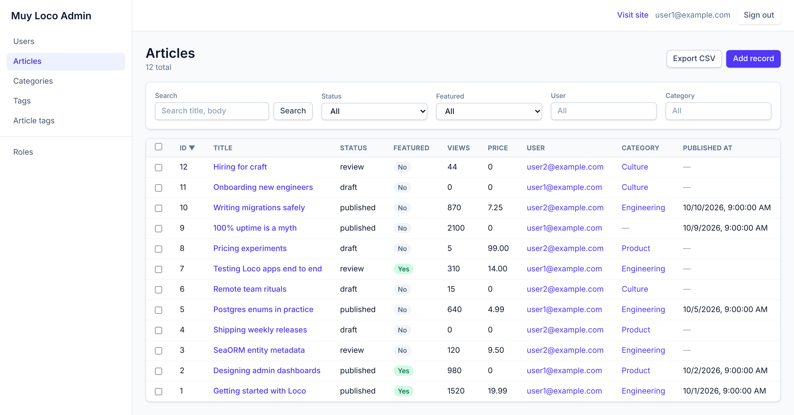
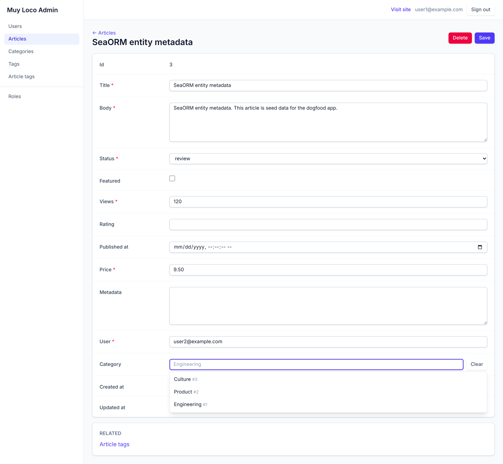
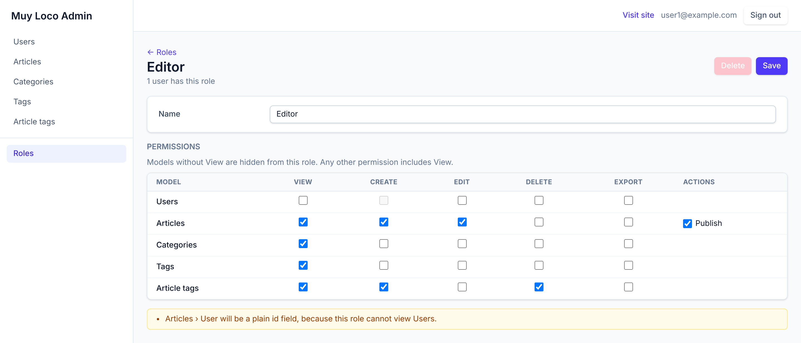

# muy-loco-admin

[](https://crates.io/crates/muy-loco-admin)
[](https://docs.rs/muy-loco-admin)
[](https://github.com/Zesuperaker/muy-loco-admin/actions/workflows/release.yml?query=branch%3Amain)
[](LICENSE)

An admin dashboard for [Loco](https://loco.rs) apps, generated from your SeaORM entities.



<details>
<summary>More screenshots</summary>




</details>

## Quickstart

Requires Loco 1.3+, Rust 1.94+ and Postgres or SQLite. These steps use an app made from Loco's
SaaS starter; for other apps, see [Not on the SaaS starter?](#not-on-the-saas-starter).

> [!TIP]
> Starting a new app? Create it from the SaaS starter:
>
> ```sh
> cargo install loco
> loco new --name myapp --db sqlite --bg async --assets serverside
> cd myapp
> ```
>
> Use `--db postgres` for Postgres.

### 1. Add the crate

```sh
cargo add muy-loco-admin
```

### 2. Add an `is_admin` column to `users`

```sh
cargo install sea-orm-cli   # `db entities` needs it
cargo loco generate migration AddIsAdminToUsers is_admin:bool
cargo loco db migrate
cargo loco db entities
```

### 3. Mount the admin

In `src/app.rs`, add the admin to the app's initializers and its `admin:promote` task to the
app's tasks:

```rust
use muy_loco_admin::{auth::JwtAuth, Admin, ModelAdmin, PromoteAdmin};

// inside `impl Hooks for App`
async fn initializers(_ctx: &AppContext) -> Result<Vec<Box<dyn Initializer>>> {
    Ok(vec![
        // ...the app's existing initializers
        Box::new(
            Admin::new(JwtAuth::<users::Model>::new(|user| user.is_admin == Some(true)))
                .register(ModelAdmin::<users::Entity>::new().can_create(false))
                // .model::<articles::Entity>()
                .middlewares_from::<Self>(),
        ),
    ])
}

fn register_tasks(tasks: &mut Tasks) {
    // ...the app's existing tasks
    tasks.register(PromoteAdmin::new(users::Column::Email, users::Column::IsAdmin));
}
```

Add a `.model::<…>()` line for each model you want to manage, or `.register(…)` one to
[configure it](https://docs.rs/muy-loco-admin/latest/muy_loco_admin/#registering-models).

### 4. Create an admin user

Skip `user:create` if you already have a user:

```sh
cargo loco task user:create email:you@example.com name:You password:change-me
cargo loco task admin:promote email:you@example.com
```

### 5. Sign in

```sh
cargo loco start
```

Open <http://localhost:5150/admin> and sign in with that email and password.

> [!IMPORTANT]
> Before deploying, go through the
> [production checklist](https://docs.rs/muy-loco-admin/latest/muy_loco_admin/#deploying-to-production).

### Not on the SaaS starter?

- **Your own login route or form fields:** see
  [the login form](https://docs.rs/muy-loco-admin/latest/muy_loco_admin/#the-login-form).
- **Not using Loco's JWT auth:** implement `AdminAuth`, see
  [your own authentication](https://docs.rs/muy-loco-admin/latest/muy_loco_admin/#your-own-authentication).
- **Create users however your app does**, then run `admin:promote`.

## Documentation

The full guide is [on docs.rs](https://docs.rs/muy-loco-admin):

| Topic | Covers |
| --- | --- |
| [Features](https://docs.rs/muy-loco-admin/latest/muy_loco_admin/#features) | what the admin can do |
| [Registering models](https://docs.rs/muy-loco-admin/latest/muy_loco_admin/#registering-models) | `.model` and `.register`, foreign keys |
| [Model options](https://docs.rs/muy-loco-admin/latest/muy_loco_admin/#model-options) | columns, search, filters, ordering, permissions |
| [Custom actions](https://docs.rs/muy-loco-admin/latest/muy_loco_admin/#custom-actions) | bulk actions on selected records |
| [Configuration](https://docs.rs/muy-loco-admin/latest/muy_loco_admin/#configuration) | path, title, "Visit site" link |
| [Authentication](https://docs.rs/muy-loco-admin/latest/muy_loco_admin/#authentication) | `JwtAuth`, login form, your own `AdminAuth` |
| [Sessions](https://docs.rs/muy-loco-admin/latest/muy_loco_admin/#sessions) | how the admin shares the app's session |
| [Roles](https://docs.rs/muy-loco-admin/latest/muy_loco_admin/#roles) | limiting what each admin user can do |
| [Middleware](https://docs.rs/muy-loco-admin/latest/muy_loco_admin/#middleware) | which app middleware applies |
| [Deploying to production](https://docs.rs/muy-loco-admin/latest/muy_loco_admin/#deploying-to-production) | the checklist |
| [Troubleshooting](https://docs.rs/muy-loco-admin/latest/muy_loco_admin/#troubleshooting) | why the admin refuses to start |

## Contributing

See [CONTRIBUTING.md](CONTRIBUTING.md).

## License

[Apache-2.0](LICENSE)
